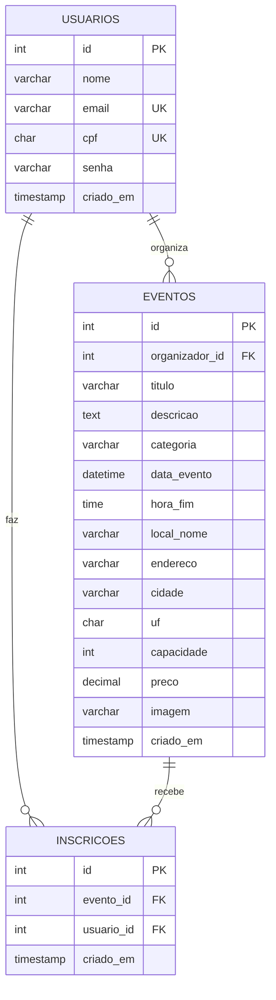

# Modelagem do banco de dados

- Um usuário pode organizar vários eventos e se inscrever em vários.
- Cada evento recebe várias inscrições; `UNIQUE (evento_id, usuario_id)` impede inscrição duplicada.
- Vagas restantes = `capacidade` menos a contagem de `inscricoes` do evento.
